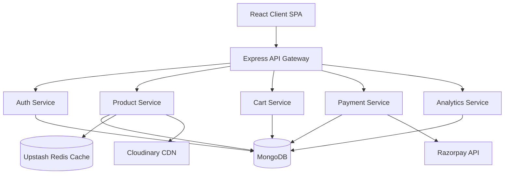
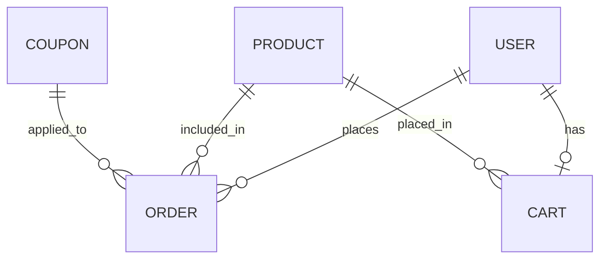

<h1 align="center">MossX</h1>

<p align="center">
  <strong>A high-performance, scalable E-Commerce platform built for modern retail experiences.</strong>
</p>

<p align="center">
  
  
  
  
  
  
</p>

---

## Overview

**MossX** is a production-ready, full-stack E-Commerce application designed to provide a seamless shopping experience for users while offering robust management capabilities for administrators.

Built with scalability and modern developer experience in mind, MossX pairs a modular Express API with a fast React storefront. It ships with a real, seeded plant catalog (32 plants, 7 bundles, 4 collections with photography and care notes), guest carts that merge on login, server-verified Razorpay payments and an admin dashboard with sales analytics.

---

## Key Features

### User Features

- **Seamless Shopping Flow**: Browse by category, search by common or botanical name with multi-category and price-range filters, and get suggestions that skip what's already in your cart.
- **Plant-first product pages**: Every plant lists its botanical name plus light, water and difficulty, with a photo credit linking to the source image.
- **Advanced Cart System**: Fully featured cart supporting both authenticated users and anonymous guest sessions with intelligent cart merging upon login.
- **Secure Authentication**: Robust JWT-based authentication with seamless token refreshing.
- **Profile & Order Management**: Track past orders, apply promotional coupons, and manage account details.

### Admin Features

- **Comprehensive Dashboard**: Real-time sales analytics and key performance indicators.
- **Inventory Management**: Create, update, and manage products, bundles, and custom collections.
- **Promotions Engine**: Issue and manage discount coupons and featured products.

### E-commerce Features

- **Dynamic Bundles & Collections**: Curate customized product offerings for specific campaigns.
- **Checkout**: Razorpay (UPI, cards, netbanking) with server-side pricing and signature verification.
- **Coupons & Discounts**: Validation engine for promotional codes.

### Security Features

- **Stateless JWT Auth**: Utilizing short-lived access tokens and secure, HttpOnly refresh tokens.
- **Robust Validation**: Input sanitization and error handling.
- **Payment Security**: Orders are priced on the server from the database (client prices are ignored) and Razorpay signatures are checked with a constant-time comparison.
- **Safe Search**: User search input is regex-escaped before it reaches MongoDB.

### Performance Features

- **Redis Caching**: Ultra-fast data retrieval for product catalogs and high-traffic queries using Upstash Redis.
- **Asset Optimization**: Cloudinary integration for scalable, optimized image delivery.
- **Efficient Bundling**: Vite-powered lazy loading and code splitting for lightning-fast frontend load times.

### Developer Experience Features

- **Monorepo Architecture**: Managed seamlessly with `pnpm` workspaces for unified dependency resolution.
- **Code Quality Guardrails**: Pre-configured ESLint, Prettier, and Husky Git hooks ensure pristine code quality.
- **Containerized Dev & Prod**: Full Docker support out of the box.

## Architecture



---

## Tech Stack

| Layer                | Technology            | Purpose                                       |
| -------------------- | --------------------- | --------------------------------------------- |
| **Frontend**         | React 18, Vite        | High-performance, reactive UI                 |
| **Styling**          | Tailwind CSS v4       | Design tokens + utility-first styling         |
| **State Management** | Zustand               | Lightweight, scalable client-side state       |
| **Backend**          | Node.js, Express      | Non-blocking, event-driven API server         |
| **Database**         | MongoDB, Mongoose     | Flexible, document-oriented data storage      |
| **Caching**          | Redis (Upstash)       | In-memory caching for reduced database load   |
| **Authentication**   | JSON Web Tokens (JWT) | Stateless, secure user session management     |
| **Payments**         | Razorpay              | Secure payment processing (INR)               |
| **Storage**          | Cloudinary            | Cloud-based image management and optimization |
| **Deployment**       | Docker                | Consistent, reproducible environments         |

---

## System Design Decisions

- **MongoDB as the Primary Data Store**: E-commerce catalogs often require flexible schemas for diverse product attributes (e.g., bundles vs. standalone products). MongoDB's document model handles this polymorphism natively without complex SQL joins.
- **Redis Caching Layer**: To handle traffic spikes during sales events, Redis is employed to cache heavily requested endpoints (like featured products and category lists). This dramatically reduces MongoDB read pressure and latency.
- **Dual-Token Authentication**: Instead of relying purely on session cookies, we use a short-lived JWT Access Token paired with a long-lived, HttpOnly Refresh Token. This mitigates CSRF and XSS risks while providing a smooth UX.
- **Guest Cart Merging Strategy**: To lower the friction of shopping, users can build their cart anonymously. The state is temporarily held, and upon authentication, the system intelligently merges the guest cart with their persistent cloud cart.
- **Pending-then-Paid Orders**: Checkout creates a `pending` order (priced server-side) alongside the Razorpay order. Only a verified payment flips it to `paid`, deactivates the used coupon, issues a gift coupon on orders of ₹999+ and empties the cart. Analytics ignore pending orders.

---

## Folder Structure

```bash
mossx/
├── backend/                  # Express server & API routes
│   ├── controllers/          # Business logic handlers
│   ├── lib/                  # Database connections & utilities
│   ├── middleware/           # Auth and validation pipelines
│   ├── models/               # Mongoose schemas
│   ├── routes/               # API endpoint definitions
│   ├── scripts/              # Catalog data + `pnpm seed` script
│   └── server.js             # Application entry point
├── frontend/                 # React SPA
│   ├── public/               # Static assets
│   ├── src/
│   │   ├── components/       # UI (home/, detail/, search/, auth/, admin forms)
│   │   ├── pages/            # Route-level views
│   │   ├── stores/           # Zustand stores (user, cart, products…)
│   │   ├── lib/              # axios, catalog helpers, Cloudinary image helper
│   │   └── index.css         # Design tokens (@theme) + shared utilities
│   ├── package.json
│   └── vite.config.js
├── Dockerfile                # Production container blueprint
├── package.json              # Monorepo configuration
└── pnpm-workspace.yaml       # Workspace definition
```

---

## Local Development Setup

### 1. Clone the repository

```bash
git clone https://github.com/your-username/mossx.git
cd mossx
```

### 2. Install dependencies

Leverage `pnpm` workspaces to install everything from the root:

```bash
npm install -g pnpm
pnpm install
```

### 3. Environment Configuration

Create a `.env` file in the root directory based on `.env.example` (or copy the provided config):

```bash
cp .env.example .env
```

**Required Environment Variables:**

- `MONGO_URI`: Your MongoDB connection string.
- `UPSTASH_REDIS_URL`: Connection string for Redis instance.
- `ACCESS_TOKEN_SECRET` / `REFRESH_TOKEN_SECRET`: Cryptographic keys for JWT signing.
- `CLOUDINARY_CLOUD_NAME` / `CLOUDINARY_API_KEY` / `CLOUDINARY_API_SECRET`: For image uploads.
- `RAZORPAY_KEY_ID` / `RAZORPAY_KEY_SECRET`: Razorpay credentials (test keys work for local development).
- `CLIENT_URL`: URL of the frontend (e.g., `http://localhost:5173`).

### 4. Seed the catalog (optional)

```bash
pnpm seed                    # upserts 32 plants, 7 bundles and 4 collections
pnpm seed --replace-legacy   # also removes the old lorem-ipsum test bundles
```

The script (`backend/scripts/seedCatalog.js`) downloads each photo from Wikimedia Commons, uploads it to Cloudinary under `mossx/`, builds collage images for bundles with Cloudinary overlays, stores author/license credits on each product and refreshes the Redis featured-products cache. It is idempotent: re-running it reuses existing uploads and updates records by name.

### 5. Run the Dev Server

```bash
pnpm dev
```

This command concurrently spins up the Vite development server (http://localhost:5173, proxying `/api` to the backend) and the Node backend using `nodemon`.

---

## API Documentation

Below is a snapshot of critical API endpoints.

| Method | Route                                   | Purpose                                             | Auth Required |
| ------ | --------------------------------------- | --------------------------------------------------- | ------------- |
| `POST` | `/api/auth/signup`                      | Register a new user account                         | No            |
| `POST` | `/api/auth/login`                       | Authenticate user & issue tokens                    | No            |
| `GET`  | `/api/products`                         | Retrieve all products (Admin)                       | Admin         |
| `GET`  | `/api/products/category/:category`      | Fetch products by category slug                     | No            |
| `GET`  | `/api/products/search`                  | Search (`q`, `category`, `minPrice`, `maxPrice`)    | No            |
| `GET`  | `/api/products/recommendations`         | Random suggestions (`?exclude=id,id`)               | No            |
| `POST` | `/api/cart`                             | Add product to user/guest cart                      | Optional      |
| `POST` | `/api/cart/merge`                       | Merge guest cart into user cart                     | Yes           |
| `POST` | `/api/payments/create-razorpay-order`   | Price the cart server-side and open a pending order | Yes           |
| `POST` | `/api/payments/verify-razorpay-payment` | Verify signature and mark the order paid            | Yes           |
| `GET`  | `/api/payments/orders/:id`              | Paid order summary for the confirmation page        | Yes           |
| `GET`  | `/api/analytics`                        | Fetch sales & revenue analytics                     | Admin         |

---

## Database Design

MossX revolves around a highly relational NoSQL design utilizing Mongoose references.

**Major Collections:**

- **Users**: Core identity management, stores hashed passwords, role (`admin`/`customer`), and cart references.
- **Products**: Name, botanical name, price, category, care notes (light / water / level), image URL and image credit.
- **Orders**: Line items (product, bundle or collection with the price charged), total, shipping address, status (`pending` / `paid`) and Razorpay order/payment ids.
- **Coupons**: Promotional codes with expiration logic and relational links to users who have utilized them.
- **GuestCarts**: Temporary storage for anonymous shoppers.



---

## Security

MossX takes a zero-trust approach to application security:

- **JWT Architecture**: Utilizing split access (memory/short-lived) and refresh (HttpOnly cookie) tokens to eliminate local storage vulnerabilities.
- **Password Cryptography**: All passwords are automatically hashed via `bcryptjs` before reaching the database.
- **Input Validation**: Strict schema enforcement at the model level preventing NoSQL injection.
- **Payment Verification**: Razorpay payment signatures are verified (timing-safe) before an order is marked paid, and prices always come from the database.
- **Rate Limiting**: (Planned) API endpoint protection against brute force and DDoS attacks.
- **Environment Isolation**: Sensitive keys are exclusively managed via `dotenv` and never exposed to the client bundle.

---

## Performance Optimizations

- **Redis Caching**: Frequent, read-heavy operations like fetching featured products or category layouts are cached in Redis, resulting in sub-50ms API response times.
- **Database Indexing**: Critical fields in MongoDB (`email`, product `category` and `isFeatured`, and Razorpay order ids) are indexed to reduce query execution time.
- **Lazy Loading**: The admin dashboard (and its charting library) is split out with `React.lazy()`, so shoppers never download it.
- **Image Optimization**: A small helper (`frontend/src/lib/image.js`) requests Cloudinary images at the exact size each component needs, with `f_auto,q_auto` for WebP/AVIF delivery.

---

## Deployment

MossX is engineered to be cloud-native and easily containerized.

### Docker Deployment

A production-grade `Dockerfile` is included at the root of the project. It uses a workspace-compatible approach to build the React application and serve it via the Express backend.

```bash
# Build the image
docker build -t mossx-app .

# Run the container
docker run -d -p 5000:5000 --env-file .env mossx-app
```

**Production Architecture:**
In a production environment, the backend serves the statically generated Vite assets (`frontend/dist`) directly when `NODE_ENV=production` is set, eliminating the need for a separate Nginx container for the frontend if a monolithic deployment is preferred. This drastically simplifies the CI/CD pipeline and local environment replication.

---

## Design System

The storefront uses a small set of design tokens defined in `frontend/src/index.css` (`@theme`):

| Token    | Value     | Use                                |
| -------- | --------- | ---------------------------------- |
| `ground` | `#FBF8F3` | Page background                    |
| `ink`    | `#1F2A1E` | Text, dark bands, footer           |
| `muted`  | `#5B6657` | Secondary text (5.9:1 on ground)   |
| `moss`   | `#4F6A47` | Primary actions (5.9:1 with white) |
| `forest` | `#07592C` | Hover states                       |
| `sage`   | `#E3EBDF` | Chips and soft fills               |
| `clay`   | `#B4532A` | Savings badges, cart count         |

Type pairs **Fraunces** (display) with **DM Sans** (body). Shared utilities (`btn-primary`, `btn-outline`, `container-page`, `field`, `chip`, `eyebrow`) keep components consistent. Interactive elements are real buttons/links with visible focus rings and 44px+ touch targets, and the layout works down to 360px wide.

---

## Catalog & Image Credits

Product photography comes from [Wikimedia Commons](https://commons.wikimedia.org/) under Creative Commons licenses (mostly CC BY-SA). The author, license and source link for every image are stored on the product (`imageCredit`) and shown under the photo on its product page. Bundle images are collages generated from those photos.

---

## Challenges & Learnings

Building MossX presented several unique engineering challenges:

- **Guest Cart Merging**: Designing an intuitive cart system for unauthenticated users that seamlessly syncs with the database post-login was tricky. We implemented a temporary local state synced with a robust `/api/cart/merge` backend endpoint, resolving edge cases where a user might log into an account that already had pre-existing cart items.
- **Cache Invalidation Strategy**: Utilizing Redis dramatically improved read speeds, but maintaining cache consistency when an admin updated a product price required careful event-driven invalidation logic in our controllers.
- **Monorepo Complexity**: Managing dependencies between the frontend and backend natively without bloated tooling. `pnpm` workspaces proved to be an elegant solution, enforcing strict boundary rules while keeping installation times significantly lower.

---

## Roadmap

- [x] JWT Authentication & Security
- [x] Razorpay integration with server-side pricing
- [x] Seeded catalog with real photography and care notes
- [x] Storefront redesign (design tokens, accessible components, responsive layouts)
- [x] Admin Analytics Dashboard
- [x] Redis Caching Implementation
- [ ] Analytics Platform Integration
- [ ] Recommendation Engine powered by user history
- [ ] Comprehensive E2E Testing with Cypress
- [ ] React Native Mobile App Companion
- [ ] Automated CI/CD Pipelines via GitHub Actions

---

## Contributing

We welcome contributions from the community! To get started:

1. Fork the repository
2. Create a feature branch (`git checkout -b feature/amazing-feature`)
3. Commit your changes utilizing conventional commits
4. Push to the branch (`git push origin feature/amazing-feature`)
5. Open a Pull Request for review

Please ensure you run `pnpm run lint` and verify the build before submitting your PR.

---

## License

This project is licensed under the ISC License. See the [LICENSE](./LICENSE) file for more details.
